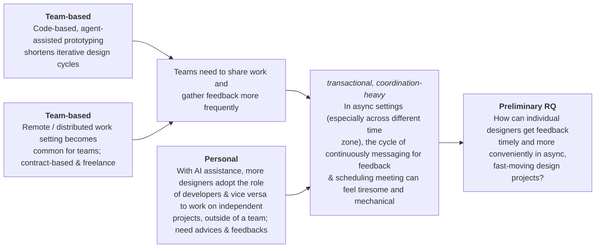

# Project Proposal

**Source:** Figma board *Capstone research* — section **"Project proposal"** (node `24:124`)
`https://www.figma.com/board/im0O0k4DLrdOmlk5NJjMaq/Capstone-research?node-id=0-1`
**Transcribed:** 2026-09-06. Board-level note next to this section: *"9.1 Write down final project proposal & develop a work plan / Create research repo."*

> Transcription note: this section of the board is mostly spatial — sticky notes wired together with
> connectors, plus one circle diagram. Text is reproduced verbatim; each diagram is described in prose
> before its contents, so nothing depends on seeing the canvas.

---

## 1. Concept

An agentic project management platform to make conducting design reviews & gather feedbacks easier

- With AI agents & remote colleagues
- reduces the delays and coordination friction of asynchronous, distributed review
- Read Figma / coding files
  - having agent directly annotate inside figma files
- track 3: improving workflow
- Utilize kanban board layout for task management

---

## 2. Context

**Diagram — causal chain, read left to right.**
Three yellow driver stickies sit on the left. The left margin labels them by where they come from:
the top two are grouped under **Team-based**, the bottom one under **Personal**. Arrows funnel the two
team-based drivers into a shared middle sticky ("teams need to share work and gather feedback more
frequently"); that sticky arrows into the pain-point sticky on the right. The personal driver runs its
own long connector that skips the middle sticky and joins the pain point directly. The pain point then
arrows into the orange **Preliminary RQ** sticky at the far right — so the whole section is one argument
ending in the research question.



### Drivers

**Team-based** — margin gloss: *"(personal connection: difficulty in group project with friends going to different colleges)"*

1. Code-based, agent-assisted prototyping shortens iterative design cycles
2. Remote / distributed work setting becomes common for teams; contract-based & freelance

**Personal**

3. With AI assistance, more designers adopt the role of developers & vice versa to work on independent
   projects, outside of a team; need advices & feedbacks

### Convergence

Drivers 1 and 2 converge on:

> Teams need to share work and gather feedback more frequently

### Pain point

Labelled above the sticky: *transactional, coordination-heavy*

> In async settings (especially across different time zone), the cycle of continuously messaging for
> feedback & scheduling meeting can feel tiresome and mechanical

### Loose annotation

Sitting below the chain, not wired to any sticky:

> Ideal setting would be a in-person studio class where there's professors and peers on standby to check-in

---

## 3. Preliminary RQ

> **How can individual designers get feedback timely and more conveniently in async, fast-moving design projects?**

---

## 4. Target audience

(People who identify their role as) product designer / design engineers / product managers

- can be students
- working with UI/UX, prototyping, vibe coding

**Diagram — three-node collaboration model.**
Three outlined circles. **Individual ("you")** sits alone on top; a horizontal rule runs beneath it,
separating it from **AI agents** and **Team members**, which sit side by side below the line. The rule
reads as the collaboration boundary: the individual is the user, the two below are the parties they
work through. Caption to the right of the line:

> Support collaboration between user and any two parties / all 3

```
                    ┌───────────────┐
                    │  Individual   │
                    │    ("you")    │
                    └───────────────┘
    ────────────────────────────────────────────   Support collaboration between
                                                   user and any two parties / all 3
        ┌───────────────┐   ┌───────────────┐
        │   AI agents   │   │ Team members  │
        └───────────────┘   └───────────────┘
```

---

## 5. Work plan

**Diagram — two columns joined by a brace.**
The left column lists the project phases in order, with a dashed divider separating the screen-based
track from a VR track. A large curly brace opens off the *first* left-hand item ("Research: user &
visual") and expands into the numbered research plan in the right column — i.e. the right column is a
zoom-in on the research phase, not a parallel timeline.

### Phases (left column)

- Research: user & visual
- Low-fi
- User testing
- Hi-fi & prototyping (can be code)

`------------`

- VR design
  - Learn Unity (alongside screen-based breakpoint development)
    - fundamentals + VR
  - Sketch out setting
  - Low-fi MVP → testing → hi-fi

### Research, expanded (right column, braced off "Research: user & visual")

1. **User research:** surveys, interview, focus group with friends in design
   1. Study across different physical devices / softwares used; what's the most commonly used combo
      1. multi-screen, use of monitors / tablets
   2. Walkthrough their daily workflow, how people jump in & out of design + coding softwares,
      _thinking out loud_ &nbsp;<sub>(underlined on the board)</sub>
2. **Literary review** (little academic research can be found)
   1. stats on job market: designer working remotely &nbsp;<sub>(purple on the board)</sub>
   2. blogs e.g. Medium & social media where designers document their usage habits &nbsp;<sub>(purple on the board)</sub>
      1. online field research / digital ethnography
3. **Competitive studies:** Study agentic task-first workflow in preexisting AI tools e.g. Claude design, Cursor Agents

---

## Appendix — unattributed sticky in this section

A pale-blue sticky sits to the right of the Context chain, below the Preliminary RQ. It has **no author**
and labels itself as disposable. Recorded here for completeness; it is a note found on the canvas, not
part of the proposal:

> [Sample agent note — safe to delete]
>
> The RQ says "individual designers," but the three-node model and the studio-class setting both assume
> peers are present. Worth deciding whether the individual is alone by circumstance (freelance) or alone
> in the moment (async). The MVP changes a lot depending on which.
